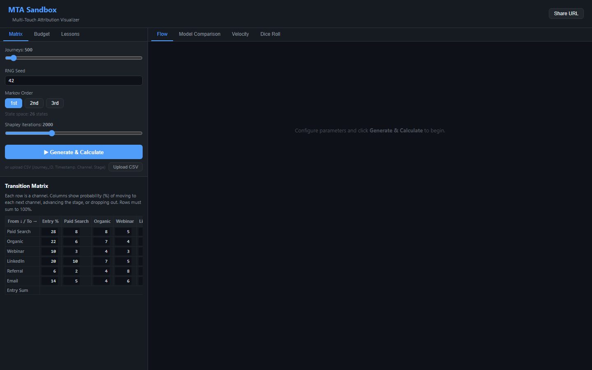

# MTA Sandbox & Visualizer
 
An interactive, browser-based **Multi-Touch Attribution sandbox** for marketing analysts and engineers. 

## MTA Overview

This sandbox and visualization tool simulates B2B SaaS customer journeys, 
compares six attribution models side-by-side, 
and explores how Markov chains and Shapley values distribute credit across channels.

---
## MTA Visualizer Overview
from docs/screenshots/mta_01_home_overview.png




---

## Problem It Solves

Marketing teams routinely over-invest in last-touch channels (Email, Paid Search closers) while under-crediting assist channels (LinkedIn, Referral, Webinar) that drive mid-funnel progression. Standard analytics platforms only offer First-Touch or Last-Touch models. This tool lets analysts explore probabilistic models (Markov, Shapley) against heuristic baselines — without needing a data warehouse, ML platform, or vendor contract.


---

## Core Features

| Feature | Description |
|---|---|
| **Synthetic journey generation** | Markov-based simulator with seeded RNG for reproducible datasets |
| **CSV upload** | Bring your own journey data (BYOD); parsed client-side |
| **6 attribution models** | First-Touch, Last-Touch, Linear, Time-Decay, Markov (1st/2nd/3rd order), Shapley Monte Carlo |
| **Animated flow visualization** | Canvas 2D particle animation for ≤1,000 journeys; D3 Sankey for >1,000 |
| **Bootstrap confidence intervals** | 95% CI bands on Markov outputs |
| **Velocity heatmap** | Average time-in-stage per channel — identify bottlenecks |
| **Budget optimizer** | Saturation-curve-based reallocation using attribution credit scores |
| **Dice Roll step-through** | Single-journey RNG replay with probability brackets |
| **Preset lessons** | 4 curated scenarios teaching attribution pitfalls |
| **Shareable URLs** | Full config serialized via gzip + Base64Url into URL params |

---

## Live Demo , Features, and Bugs
[Live Demo Link ](Link Coming Soon)

[Report Bug](Link Coming Soon) · 

[Request Feature](Link Coming Soon)

---
## Tech Stack

| Layer | Technology |
|---|---|
| UI Framework | React 18 + TypeScript |
| Build Tool | Vite 4 |
| State Management | Zustand 5 (3 stores) |
| Math / Linear Algebra | ml-matrix 6 |
| Worker Threading | Web Workers + Comlink 4 |
| Visualization (LOD ≤1k) | Canvas 2D API + requestAnimationFrame |
| Visualization (LOD >1k) | D3 7 + d3-sankey |
| URL Persistence | pako (gzip) + Base64Url |
| Testing | Jest 29 + ts-jest + babel-jest |

---

## Architecture

```
Main Thread (React + Zustand)          Web Worker Thread (Comlink)
─────────────────────────────         ────────────────────────────
useConfigStore  ←→  ConfigPanel        AttributionEngine
useDataStore    ←→  Visualizers    ←── IAttributionEngine interface
useResultStore  ←→  Charts             (Markov, Shapley, heuristics,
                                        bootstrap, velocity)
         ↑ Uint32Array buffers only ↑
         (Wasm-ready boundary)
```

All computation runs off the main thread. The `DictionaryEncoder` converts strings to integers before crossing the worker boundary — making a future Rust/Wasm engine swap a drop-in replacement with no UI changes.

---

## Installation

```bash
git clone <repo-url>
cd "multi-touch attribution tool"
npm install
npm run dev
```

Open `http://localhost:5173` in your browser.

---

## Screenshots

See [docs/SCREENSHOT_INDEX.md](docs/SCREENSHOT_INDEX.md) 

---

## Known Limitations

- **Client-side only** — no backend, persistence, or user accounts
- **CSV only** — no live CRM (Salesforce/HubSpot) integration
- **Shapley is slow** — Monte Carlo at 500+ iterations takes 2–5 seconds in JS (would be ~10× faster in Wasm)
- **No revenue weighting** — attribution is by conversion count, not deal value
- **Single-period model** — no seasonality or time-series decomposition

---

## Future Direction

- Rust/Wasm engine (the `IAttributionEngine` interface boundary is already in place)
- Gradient ascent budget optimizer (currently grid search)
- Position-based and custom-weight attribution models
- Deal-value-weighted attribution
- Backend persistence with scenario comparison history

See [ROADMAP.md](ROADMAP.md) for prioritized next steps.

---

## Related Docs

- [PROJECT_SUMMARY.md](PROJECT_SUMMARY.md) — Executive overview
- [ROADMAP.md](ROADMAP.md) — Prioritized next steps

## License

Copyright © M. Kyle Craig. All rights reserved.

This repository and its contents are made publicly visible solely for review and evaluation purposes. 
No permission is granted to copy, distribute, modify, or create derivative works from this software for commercial or non-commercial purposes without explicit written consent from the author.
